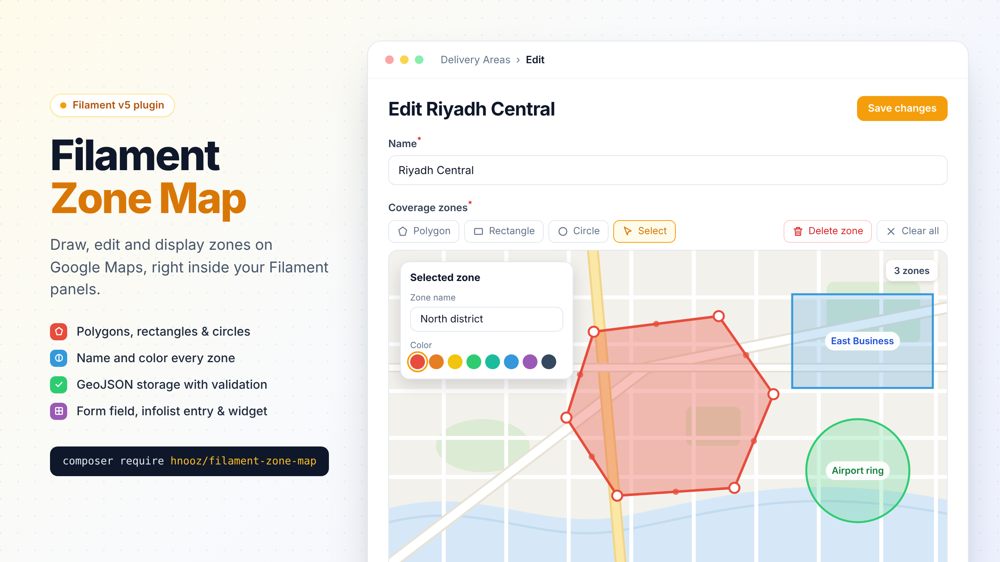

# Filament Zone Map

[](https://packagist.org/packages/hnooz/filament-zone-map)
[](https://github.com/hnooz/filament-zone-map/actions/workflows/run-tests.yml)
[](https://packagist.org/packages/hnooz/filament-zone-map)
[](https://github.com/hnooz/filament-zone-map/blob/main/LICENSE.md)

Draw, edit and display geographic **zones** on Google Maps in Filament: delivery areas, service coverage, sales territories, geofences.



## Features

- **Form field:** draw polygons, rectangles and circles; drag, reshape and delete zones
- **Zone editor:** name each zone and pick its color from your palette
- **Infolist entry:** read-only map with zone names on click
- **Dashboard widget:** zones of many records on one map, linked to each record
- **GeoJSON storage** in a plain `json` column (MySQL, PostgreSQL, SQLite, SQL Server)
- **Server-side validation** of structure, coordinates, limits, names and colors
- **Map styling:** Google Cloud `mapId` or JSON styles, light/dark following Filament's theme
- Built on [Terra Draw](https://github.com/JamesLMilner/terra-draw), not Google's deprecated Drawing Library
- Translatable, dark mode ready, loads its JS only on pages that show a map

## Requirements

| | Version |
|---|---|
| PHP | 8.3+ |
| Laravel | 12 or 13 |
| Filament | 5 |

## Installation

```bash
composer require hnooz/filament-zone-map
php artisan filament:assets
```

Optionally publish the config file:

```bash
php artisan vendor:publish --tag="filament-zone-map-config"
```

### Google Maps API key

1. In [Google Cloud Console](https://console.cloud.google.com), enable billing and the **Maps JavaScript API**.
2. Create an API key under **APIs & Services → Credentials**.
3. Restrict it, because the key is visible in the browser:
   - **Application restrictions:** Websites → your domains (e.g. `https://admin.example.com/*`)
   - **API restrictions:** Maps JavaScript API only
4. Add it to `.env`:

```dotenv
FILAMENT_ZONE_MAP_BROWSER_KEY=your-browser-key
FILAMENT_ZONE_MAP_CENTER_LAT=24.7136
FILAMENT_ZONE_MAP_CENTER_LNG=46.6753
FILAMENT_ZONE_MAP_ZOOM=11
```

`GOOGLE_MAPS_API_KEY` is used as a fallback when `FILAMENT_ZONE_MAP_BROWSER_KEY` is not set.

## Database and model

Add a nullable `json` column and cast it:

```php
Schema::table('branches', function (Blueprint $table) {
    $table->json('coverage')->nullable();
});
```

```php
use Hnooz\FilamentZoneMap\Casts\AsZoneCollection;

class Branch extends Model
{
    protected function casts(): array
    {
        return ['coverage' => AsZoneCollection::class];
    }
}
```

## Form field

```php
use Hnooz\FilamentZoneMap\Forms\Components\ZoneMap;

ZoneMap::make('coverage')
    ->shapes(['polygon', 'rectangle', 'circle'])
    ->maxZones(5)
    ->maxVertices(300)
    ->editableZones()
    ->required()
    ->columnSpanFull();
```

| Method | Default | Description |
|---|---|---|
| `shapes(array)` | all | Shapes users can draw: `polygon`, `rectangle`, `circle` (or `ZoneShape` enums) |
| `multiple(bool)` | `true` | `false` limits the field to one zone |
| `maxZones(?int)` | config (`10`) | Maximum number of zones |
| `maxVertices(?int)` | config (`500`) | Maximum points per zone |
| `editableZones(bool)` | `false` | Show the name and color panel for the selected zone |
| `colors(array)` | config | `#RRGGBB` palette for the zone editor |
| `zoneColor(string)` | `#E74C3C` | Default zone color |
| `center(lat, lng)` / `zoom(int)` | config | Initial viewport (the map fits to existing zones) |
| `height(string)` | `480px` | CSS length (`px`, `rem`, `em`, `vh`, `%`) |
| `mapId(?string)` / `styles(?array $light, ?array $dark)` | config | Map styling (see below) |

All methods accept closures. `required()` also fails when the field has no zones. `disabled()` shows the zones without the toolbar.

## Infolist entry

```php
use Hnooz\FilamentZoneMap\Infolists\Components\ZoneMapEntry;

ZoneMapEntry::make('coverage')
    ->height('360px')
    ->placeholder('No zones yet')
    ->columnSpanFull();
```

Zones are shown read-only; clicking a zone shows its name. `fitBounds(false)` keeps the configured center and zoom. The entry supports the same `center`, `zoom`, `height`, `zoneColor`, `mapId` and `styles` methods as the field.

## Dashboard widget

Create a class in `app/Filament/Widgets` that extends `ZonesMapWidget`. Panels that discover widgets pick it up automatically.

```php
namespace App\Filament\Widgets;

use App\Filament\Resources\Branches\BranchResource;
use App\Models\Branch;
use Hnooz\FilamentZoneMap\Widgets\ZonesMapWidget;
use Illuminate\Database\Eloquent\Builder;
use Illuminate\Database\Eloquent\Model;

class BranchCoverageMap extends ZonesMapWidget
{
    protected ?string $heading = 'Branch coverage';

    protected string $zonesColumn = 'coverage';

    protected ?string $labelColumn = 'name';

    protected int $maxRecords = 200;

    protected function getZonesQuery(): Builder
    {
        return Branch::query()->where('is_active', true);
    }

    protected function getRecordUrl(Model $record): ?string
    {
        return BranchResource::getUrl('edit', ['record' => $record]);
    }

    protected function getMapOptions(): array
    {
        return ['height' => '560px', 'center' => [24.7136, 46.6753], 'zoom' => 10];
    }
}
```

Clicking a zone shows its name, the record label and a link to the record. Only relative and `http(s)` URLs are used.

## Map styling

**Cloud styling (recommended):** create a Map ID in Google Cloud (Map management → JavaScript → Vector), style it there, and set:

```dotenv
FILAMENT_ZONE_MAP_MAP_ID=your-map-id
```

The map uses Google's light or dark color scheme to match Filament's theme.

**JSON styles:** without a Map ID, pass [JSON style arrays](https://developers.google.com/maps/documentation/javascript/style-reference) per theme, either per component or in `config/filament-zone-map.php`:

```php
ZoneMap::make('coverage')->styles(light: $lightStyles, dark: $darkStyles);
```

Google ignores JSON styles when a Map ID is set.

## Data format

Zones are stored as a GeoJSON `FeatureCollection`. Every shape is a `Polygon`; coordinates are `[lng, lat]`.

```json
{
  "type": "FeatureCollection",
  "features": [{
    "type": "Feature",
    "id": "8f0c…",
    "geometry": { "type": "Polygon", "coordinates": [[[46.67, 24.71], [46.70, 24.71], [46.70, 24.74], [46.67, 24.71]]] },
    "properties": { "shape": "polygon", "name": "North", "color": "#E74C3C", "radius_m": null }
  }]
}
```

`radius_m` is set for circles only. A record without zones is stored as `NULL`.

## Working with zones in PHP

```php
$zones = $branch->coverage;          // ?ZoneCollection

$zones?->count();
$zones?->find('8f0c…')?->name;

foreach ($zones ?? [] as $zone) {
    $zone->shape;                    // ZoneShape enum
    $zone->rings;                    // [[[lng, lat], ...]]
    $zone->color;
    $zone->radiusMeters;             // circles only
}

$branch->coverage = $geoJsonArrayOrJson;   // validated structurally by the cast
```

Validate API input with the same rules as the form:

```php
use Hnooz\FilamentZoneMap\Rules\ValidZoneCollection;
use Hnooz\FilamentZoneMap\Support\ZoneLimits;

$request->validate([
    'coverage' => ['required', new ValidZoneCollection(new ZoneLimits(maxZones: 5), required: true)],
]);
```

## Configuration

`config/filament-zone-map.php`:

| Key | Default | Description |
|---|---|---|
| `browser_key` | env | Google Maps browser key |
| `language` / `region` | app locale / null | Map labels language and region bias |
| `defaults.center` / `defaults.zoom` / `defaults.height` | `0,0` / `2` / `480px` | Initial viewport and height |
| `map_id` | env | Cloud styling Map ID |
| `styles.light` / `styles.dark` | `null` | JSON styles when no Map ID |
| `zone_color` / `colors` | `#E74C3C` / 8 colors | Default color and editor palette |
| `limits.max_zones` / `max_vertices` / `max_name_length` | `10` / `500` / `100` | Validation limits |

## Translations

```bash
php artisan vendor:publish --tag="filament-zone-map-translations"
```

## Testing

```bash
composer test      # Pest
composer analyse   # PHPStan
npm test           # JS unit tests
```

## Changelog

See [CHANGELOG](https://github.com/hnooz/filament-zone-map/blob/main/CHANGELOG.md).

## Security

Please report security issues by email to the author instead of opening a public issue.

## Credits

- [Mohamed Idris](https://github.com/hnooz)
- [Terra Draw](https://github.com/JamesLMilner/terra-draw)

## License

MIT. See [LICENSE](https://github.com/hnooz/filament-zone-map/blob/main/LICENSE.md).
